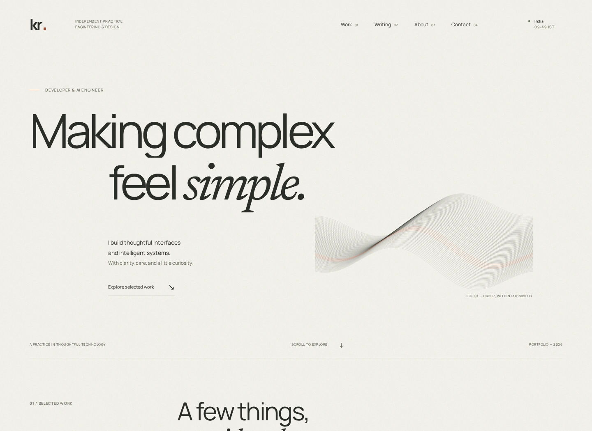
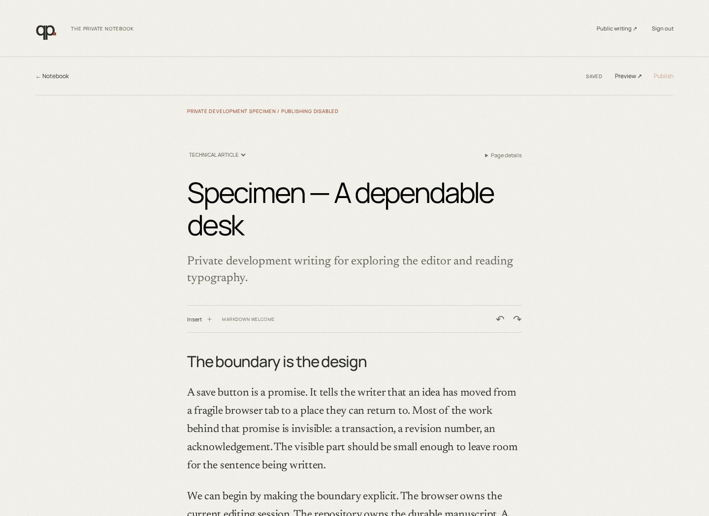
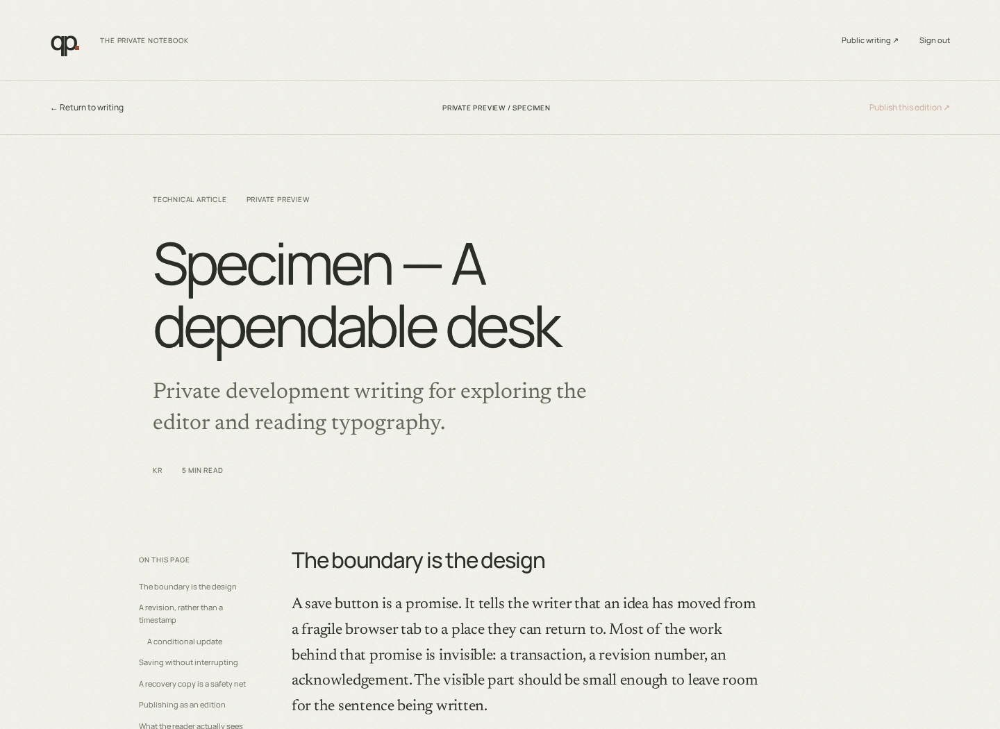
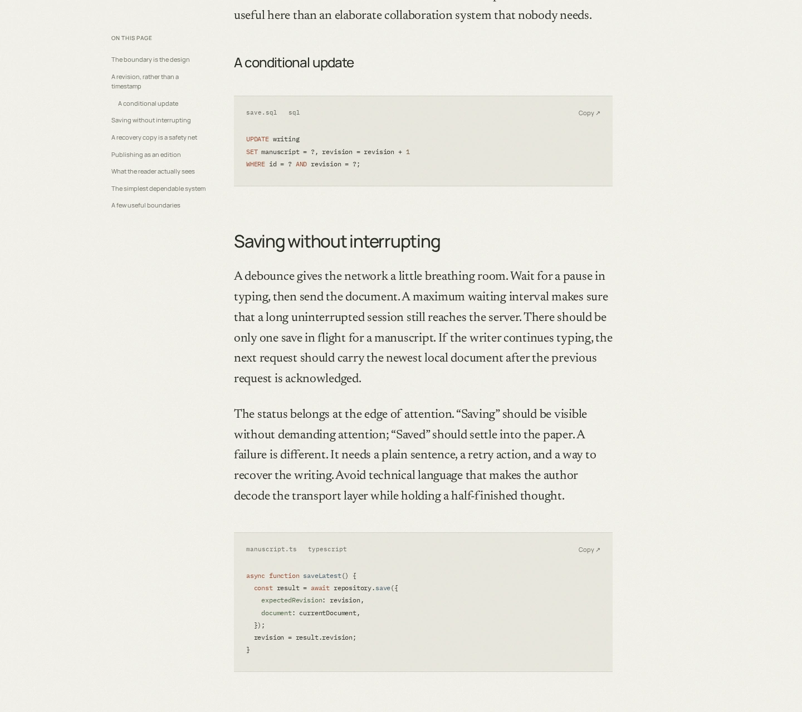
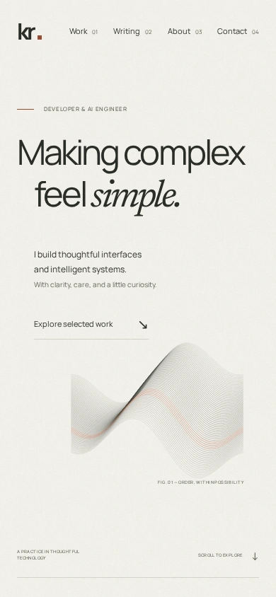

# Betweenleaf

**A quiet home for work and writing.**

Betweenleaf is an experimental, open-source personal website and publishing application. I built it to explore editorial web design, restrained motion, and what it feels like to write and publish from the same place.

It pairs a public collection of work and writing with a private, single-author Studio. The interface draws on Japanese minimalism: warm paper, generous margins, careful typography, and movement that connects pages without interrupting reading.

This is a standalone project, not my personal portfolio. The included project studies are interactive examples, not accounts of client work. There is no live deployment at present.



## What it does

- Presents selected work through editorial case studies and three browser-local demonstrations.
- Collects notes, weeknotes, essays, technical articles, and build logs in one Writing archive.
- Provides a custom Plate editor with headings, links, lists, quotations, code, images, captions, Markdown shortcuts, rich-text paste, and Markdown export.
- Autosaves drafts with revision checks and device-local recovery during connection failures.
- Previews the actual public article before publishing it.
- Keeps a published edition separate from unfinished edits; supports republishing, unpublishing, archiving, restoring, and deleting.
- Serves published article HTML, metadata, RSS, and a sitemap from the Worker.
- Connects routes with native View Transitions, with reduced-motion support and ordinary browser history.

The writing database starts empty. Optional development specimens are clearly marked and cannot be published. Browser tests create and remove temporary writing locally.

## A closer look

The private Studio and article preview share the same typography and materials. These captures use a private development specimen, not published writing.

| The writing desk                                                                                                                                                      | The reading preview                                                                                                                                |
| --------------------------------------------------------------------------------------------------------------------------------------------------------------------- | -------------------------------------------------------------------------------------------------------------------------------------------------- |
| [](docs/images/studio.webp) | [](docs/images/reading.webp) |
| Autosave and formatting stay at the edge of the page.                                                                                                                 | Preview uses the same renderer as public articles.                                                                                                 |

<details>
<summary>Technical writing and the mobile layout</summary>

Language labels, filenames, syntax highlighting, and code copying are part of the reading surface.



The homepage keeps its editorial composition on a narrow screen.



</details>

## Stack

React 19, Vite 8, TypeScript, file-based TanStack Router, TanStack Query, Tailwind CSS, and Plate 53. A Hono Worker handles the API, authentication, public article rendering, and feeds. Cloudflare D1 stores documents and media metadata; R2 stores uploaded images.

Oxlint, Oxfmt, Knip, and Playwright provide the quality gate. Fonts are self-hosted Manrope, Newsreader, and IBM Plex Mono.

This is a full-stack application. A static upload to GitHub Pages cannot run the Studio, database, uploads, or dynamic publication routes.

## Run locally

Use Node.js 24 and pnpm 12.4.2, matching CI. Node.js 22.18 or later is also supported by the application. All JavaScript package commands use pnpm.

```sh
pnpm install --frozen-lockfile
cp .env.example .env
cp .dev.vars.example .dev.vars
pnpm db:migrate
pnpm dev
```

Open <http://localhost:3000>. Visit `/studio` and use the development passphrase from `.dev.vars.example`. The exact example passphrase is rejected on deployed origins. Local D1 and R2 data stay in the ignored `.wrangler/state` directory; no Cloudflare account is needed for local development.

`.env` configures browser/build URLs. `.dev.vars` contains local Worker configuration and secrets. Both are ignored by Git. Never put a passphrase in a `VITE_` variable: those values are public browser configuration.

## Verify

```sh
pnpm exec playwright install chromium
pnpm check
```

`check` runs route generation, strict TypeScript, lint, formatting, unused-code checks, the production build, browser tests, and an independent build under `/portfolio/`. Tests cover authentication, publication boundaries, autosave recovery, revisions, media, keyboard use, reduced motion, responsive layouts, direct routes, refresh, and history.

```sh
pnpm build
pnpm preview
```

The production preview runs at <http://localhost:4173>. It uses the same local bindings and passphrase. Its metadata uses the configured canonical origin rather than the preview address.

Individual checks: `pnpm typecheck`, `pnpm lint`, `pnpm format:check`, `pnpm knip`, and `pnpm test`.

GitHub Actions runs the quality gate and production dependency audit on pushes and pull requests. It has read-only repository permissions and no deployment credentials, publishing steps, or release automation.

## Optional deployment to Cloudflare

Deployment is entirely optional. These instructions create resources in **your own Cloudflare account**. Workers, D1, and R2 are separate services; check their current plans and enable R2 before deploying. The repository does not include an existing cloud project or resource credentials.

### 1. Create storage

```sh
pnpm exec wrangler login
pnpm exec wrangler d1 create betweenleaf
pnpm exec wrangler r2 bucket create betweenleaf-media
```

In `wrangler.jsonc`, add the returned D1 `database_id` to the `DB` entry. Keep the binding names `DB` and `FILES`; update resource names if you chose different ones. The default rate-limiter namespace is `1001`; choose another positive integer string if that namespace is already used in your account.

### 2. Set the origin

Choose your Worker URL, such as `https://betweenleaf.YOUR-WORKERS-SUBDOMAIN.workers.dev`, or configure a custom domain. Set the same origin in both places:

- `wrangler.jsonc` → `vars.SITE_URL`.
- `.env` → `VITE_SITE_URL`.

Keep `VITE_BASE_PATH=/` for a normal deployment. If using a prefix, give it leading and trailing slashes, for example `/portfolio/`. Vite configures the matching Worker `BASE_PATH` automatically. The default `example.com` origin must be replaced before deploying.

Keep the local `.dev.vars` file local. Wrangler secrets are configured separately on the deployed Worker; that file is not a production credential bundle.

### 3. Build, migrate, and deploy

```sh
pnpm check
pnpm build
pnpm exec wrangler d1 migrations apply DB --remote
pnpm exec wrangler deploy
```

Vite produces `dist/client` and `dist/server`. Wrangler discovers the generated Worker configuration automatically after the build; deploy the complete application rather than uploading `dist/client` alone.

### 4. Configure the Studio passphrase

Generate a unique random passphrase in a password manager, at least 32 characters long, and enter it at Wrangler's interactive secret prompt:

```sh
pnpm exec wrangler secret put STUDIO_PASSWORD
```

Studio sign-in fails closed until this secret is configured. The example development passphrase does not work remotely. Open `/studio`, sign in, create a private draft, reload it, and preview it before using the installation for real writing.

Later deployments can use `pnpm run deploy`, which builds and uploads the Worker. That command is never run by CI. Apply any new database migrations explicitly before deploying changes that depend on them.

## Authentication

Studio has one author and one server-side passphrase. There are no accounts, email addresses, OAuth providers, or user-management screens to configure.

A successful sign-in creates a seven-day HMAC-signed cookie using Hono's maintained cookie helpers. It is HttpOnly and SameSite Strict, with Secure and a `__Host-` prefix over HTTPS. The server checks signature and expiry on every protected request. Cloudflare's rate-limiter binding limits login attempts; mutations also require a same-origin request and a custom request header.

The passphrase is never stored in browser storage. Changing `STUDIO_PASSWORD` invalidates every existing session. Signing out clears the current browser cookie; an already copied session remains valid until expiry or passphrase rotation. Keep the passphrase strong and the deployed origin HTTPS. Public Writing remains readable without signing in; unpublished manuscripts and draft media remain private.

This intentionally small authentication model is for a personal experiment, not a multi-user publishing service.

## Content and customization

Plate's structured JSON is the only editable content format. HTML, plain text, excerpts, reading time, feeds, and Markdown exports are derived. Publishing stores a read-only snapshot, so saving changes to a published manuscript does not silently change its public edition. The first publication locks its slug. Unpublishing revokes public text and media access.

Images are resized and compressed to WebP before upload, then validated by the server. Alt text is required. D1 is the durable source; IndexedDB recovery is only a temporary device-local safety net.

Useful starting points:

| Location                          | Responsibility                                                      |
| --------------------------------- | ------------------------------------------------------------------- |
| `src/content`                     | Example identity, selected work, and site defaults                  |
| `src/routes`                      | Typed file routes and lazy boundaries                               |
| `src/features/writing`            | Schema, Plate configuration, editor, Studio, and public renderer    |
| `src/server`                      | Authentication, API, storage, article HTML, and discovery documents |
| `db/schema.ts`, `drizzle/`        | Database schema and migrations                                      |
| `src/styles`, `src/lib/motion.ts` | Typography, design tokens, and motion                               |

The sample site retains a fictionalized KR identity and original interface studies. Replace those, the favicon/social artwork, and metadata when making your own site. The design and writing systems can also be studied independently without deploying anything.

Architecture, motion, and research notes are in [`docs/`](docs/). The project is experimental, and test results describe the tested artifact rather than a promise of production support or fixed performance scores.

To refresh the README screenshots, start `pnpm dev` in one terminal and run `pnpm assets:readme` in another. The capture script only targets localhost, creates a private specimen, and deletes it afterwards. It never publishes writing. Screenshots are compressed WebP files stored in `docs/images`, separate from the application's production assets.

## License

Original code and project artwork are licensed under MIT; see [LICENSE](LICENSE). Bundled fonts retain their SIL Open Font License notices in `public/fonts`. Dependencies retain their respective licenses.
